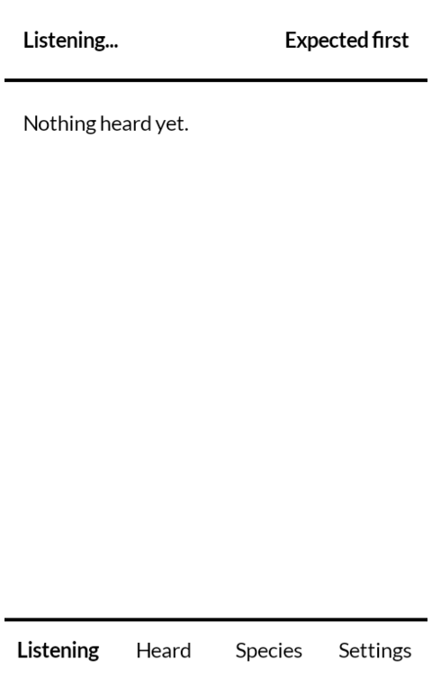
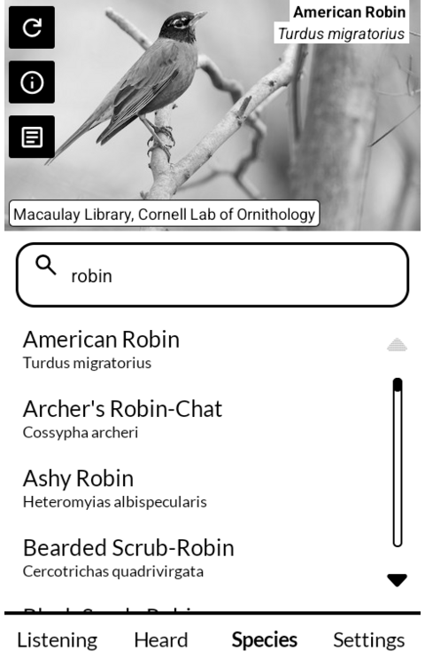
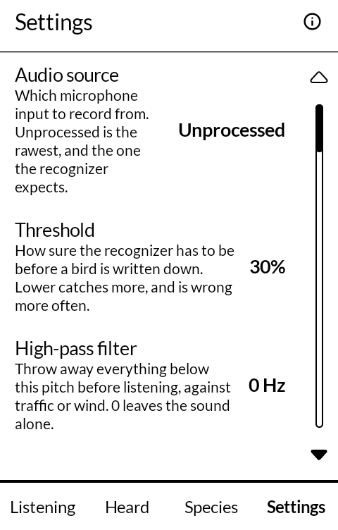
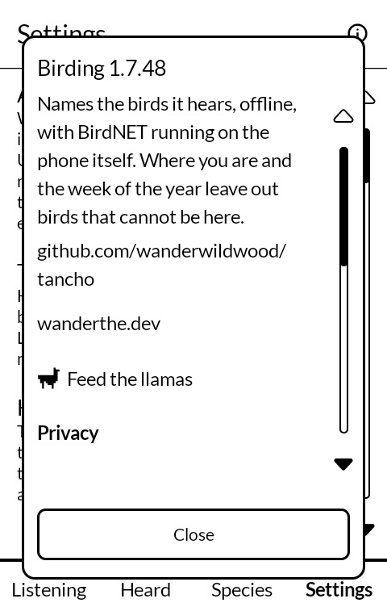

# 探鳥 tanchō — Birding

Identifies birds by their song, on the [Mudita Kompakt](https://mudita.com/products/kompakt/).
Listens through the microphone and names what it hears, offline.

*Tanchō* is 探鳥 — bird-seeking, the ordinary word for going out to look for birds; 探鳥会 is a
birdwatching outing. This is the seeking half of it: you stop walking, hold still, and it tells you
what is singing.

Fork of [whoBIRD](https://github.com/woheller69/whoBIRD) by woheller69.

| | |
|---|---|
|  |  |
|  |  |

## How it works

Recognition is [BirdNET](https://github.com/kahst/BirdNET-Analyzer), running on the phone.
Nothing is sent away to be identified. The model (about 41 MB with the location model below)
is part of the app, so it works from the first run with no network at all. It is checked
against its SHA-256 each time the app starts. The only thing the app fetches is a bird's
photograph, when one is shown (see below).

A second, much smaller model narrows the answer by where you are and what week of the year
it is, so a bird that cannot be here now is not offered. That is what the location permission
is for, and it can be turned off in settings.

Photographs come from the Macaulay Library's image server when you open a species, or as a
bird is heard if **Photo while listening** is on in Settings; they are the one reason the app
has the internet permission. A bird's photograph carries two buttons: one opens its eBird page, the other its Wikipedia
article, in the language the bird names are set to. Both open in your browser; the app does
not fetch or keep either page.

Detections are kept in a database on the phone, viewable, exportable and deletable from the
app. What the app records, stores and sends is set out in [PRIVACY.md](PRIVACY.md).

## Building

    sh models/fetch.sh        # once: fetches the two BirdNET models and checks them by hash
    ./gradlew assembleRelease

The models are not committed (about 41 MB). `models/fetch.sh` takes them from one fixed commit
of whoBIRD-TFlite and refuses them unless each matches its SHA-256; the build checks the same
hashes again before packing them, and fails if they are missing.

Release builds are signed with a keystore in `signing/`, which is gitignored. There is no
fallback: without it `assembleRelease` produces an *unsigned* APK, which will not install
anywhere. That is deliberate — a signing key committed to a public repo is not a signing key,
it is a formality, and a missing one should stop you rather than quietly hand you something
installable. (`assembleDebug` still works: signed with the key in `signing/` when it is
there, so a debug build can update a release one, and with the usual Android debug key when
it is not.)

## Getting it, and keeping it

Download <https://github.com/wanderwildwood/tancho/releases/latest/download/tancho.apk> and
sideload it. That address always points at the newest release, and every release publishes a
`.sha256` beside the APK if you would rather check than trust.

For updates without doing this by hand, add this repository to
[Obtainium](https://github.com/ImranR98/Obtainium):

    https://github.com/wanderwildwood/tancho

It will offer each new release as it appears. **The application id is settled** — updates
install over what you have, keeping your settings and anything the app has stored.

Questions, ideas, or just saying hello: the wander the dev Discord, <https://discord.gg/UMW8yJg7dQ>

## License

GPL-3.0-only. Upstream whoBIRD is © woheller69; the parts of this app that came from there are still
under that license, and the rest is too.

- Built on the [BirdNET framework](https://github.com/kahst/BirdNET-Analyzer) by
  [@kahst](https://github.com/kahst), published under CC BY-NC-SA 4.0.
- Carries the BirdNET TFLite models (`BirdNET_GLOBAL_6K_V2.4_Model_FP16.tflite` and
  `BirdNET_GLOBAL_6K_V2.4_MData_Model_V2_FP16.tflite`) from
  [whoBIRD-TFlite](https://github.com/woheller69/whoBIRD-TFlite) at commit
  `a79d101796654cf22f46383328547def828510e8`, also CC BY-NC-SA 4.0.
  **No commercial use.**
- Label files from BirdNET are used under GPLv3, with
  [permission from the author](https://github.com/woheller69/whoBIRD/issues/1).
- Uses code from the [TensorFlow Lite examples](https://www.tensorflow.org/lite/examples),
  Apache 2.0.
- Uses [iirj](https://github.com/berndporr/iirj), Apache 2.0.
- The launcher icon is [whoBIRD](https://github.com/woheller69/whoBIRD)'s icon by woheller69, redrawn in
  black and white. `misc/` holds the CC0 robin photograph that came with whoBIRD.
